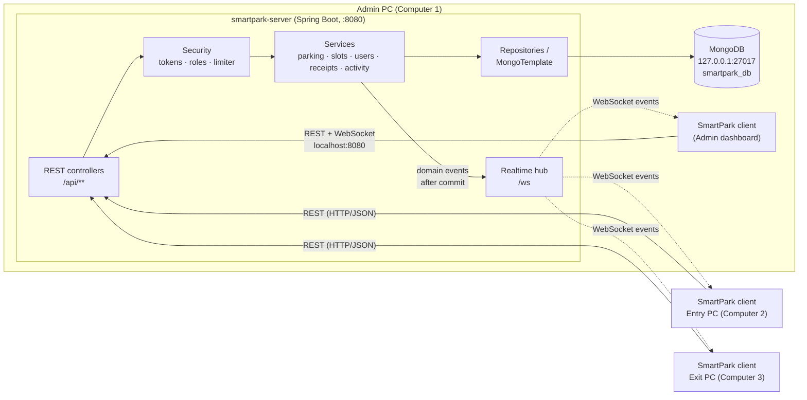
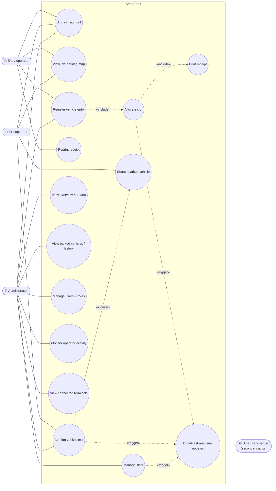
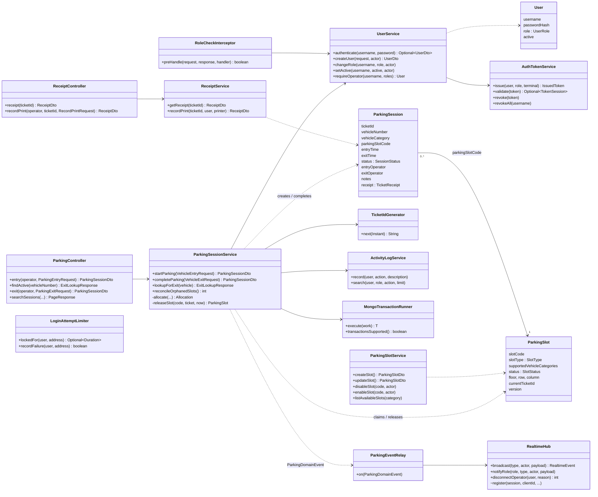
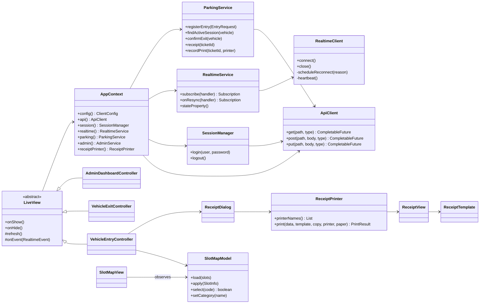
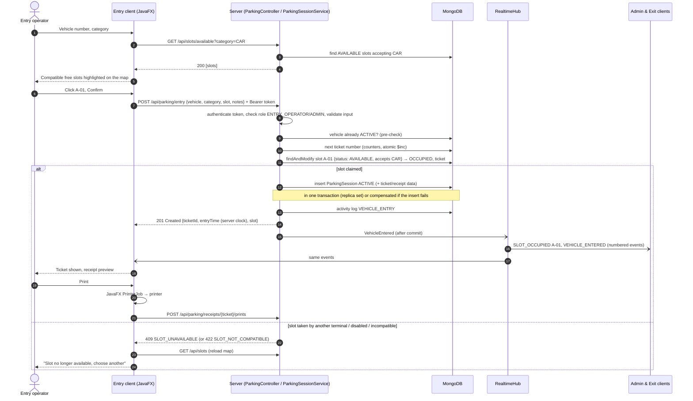
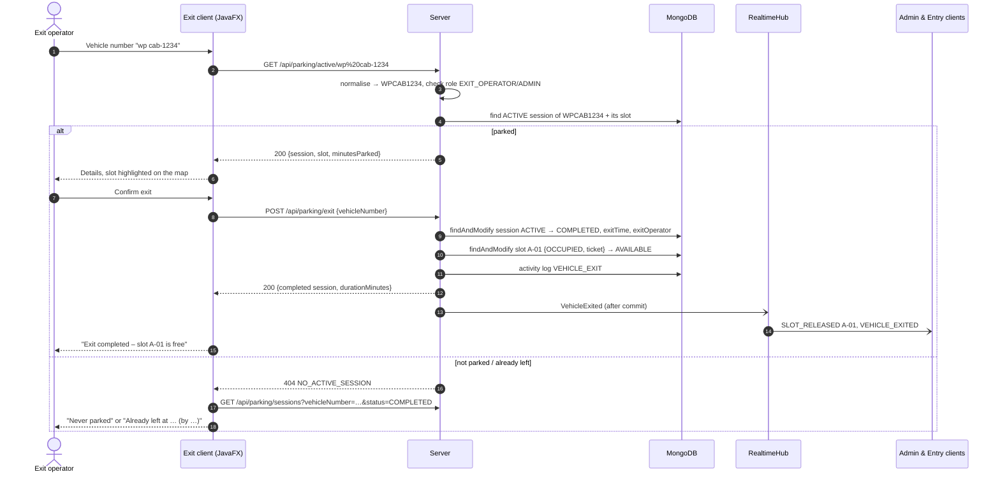
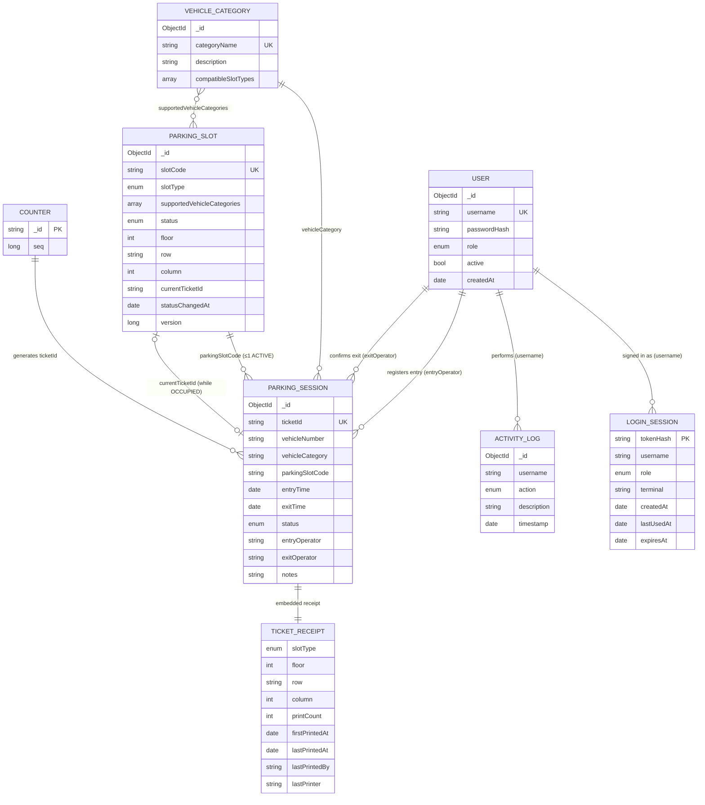
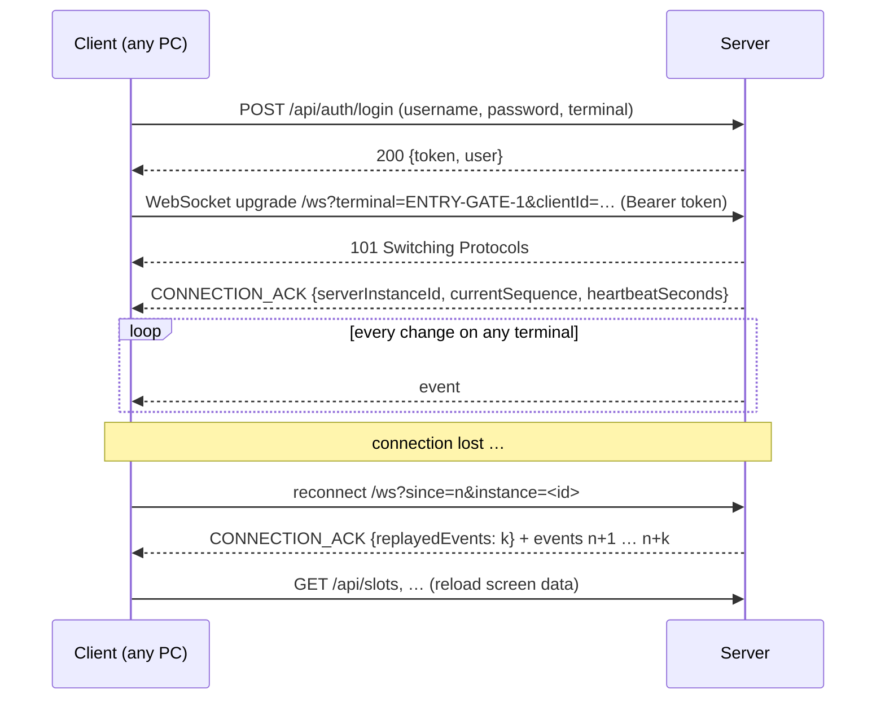

# SmartPark – Real-Time Smart Parking Management System

**Project report** · Network Programming · Java 21 · Spring Boot · JavaFX · MongoDB · REST + WebSocket

| Document | Contents |
|---|---|
| This report | Overview, problem, objectives, requirements, architecture, UML diagrams, database, network design, limitations |
| [API.md](API.md) | REST API reference (also live as Swagger UI at `http://<server>:8080/swagger-ui.html`) |
| [REALTIME.md](REALTIME.md) | WebSocket protocol, reliability, test client |
| [DEPLOYMENT.md](DEPLOYMENT.md) | Installation on three Windows PCs (network, firewall, MongoDB, packages) |
| [USER_MANUAL.md](USER_MANUAL.md) | How the admin, entry operator and exit operator use the system |
| [TESTING.md](TESTING.md) | Test results |
| [SECURITY.md](SECURITY.md) | Security and reliability measures |
| [DEMO.md](DEMO.md) | University demonstration scenario with three computers |
| [CLIENT.md](CLIENT.md) | How the JavaFX client is built |

---

## 1. Project overview

SmartPark manages a car park from three computers on one LAN or Wi-Fi network:

* **Entry PC.** The entry operator registers an arriving vehicle, picks a free compatible slot on a live graphical map, and prints a parking ticket (receipt).
* **Exit PC.** The exit operator finds the vehicle, checks its session and confirms the exit, which frees the slot.
* **Admin PC.** Runs the central **Spring Boot server** and the **MongoDB** database. The administrator uses the dashboard for live occupancy, the parking map with vehicle numbers, history, slot and user management, and operator activity.

Every change is decided by the server, stored in the database (the **single source of truth**) and pushed to every connected computer in real time through a **WebSocket**. All three screens therefore show the same state within a fraction of a second, without refreshing. Two operators can never be given the same slot.

| | |
|---|---|
| Size | 182 Java source files, about 13 300 lines (server and client); 207 automated tests |
| Modules | `smartpark-server` (Spring Boot 4.1 backend), `smartpark-client` (JavaFX 21 desktop application, used on all three PCs) |
| Communication | REST (HTTP/JSON) for commands and queries; WebSocket for real-time events; one TCP port (8080) |
| Database | MongoDB Community Server, local on the Admin PC, password-protected, reachable only by the server |

## 2. Problem statement

Many small and medium car parks (universities, hospitals, shopping centres) still manage spaces with paper tickets, whiteboards or a single stand-alone PC. This causes:

1. **No shared, current view.** The entry gate does not know which spaces the exit gate has just freed, and the office sees occupancy only by walking around or phoning the gates.
2. **Double allocation.** Two attendants can send two cars to the same space, because nothing coordinates their decisions.
3. **Lost or disputed tickets.** There is no reliable record of when a vehicle entered, who registered it or where it parked, and no way to reprint a ticket.
4. **No accountability or statistics.** Operator actions are not logged, and occupancy and traffic figures are not available.
5. **Fragility.** A dropped network connection or a restarted PC leaves the stations inconsistent.

SmartPark solves these problems with a client–server network application in which a central server owns the state, enforces the rules atomically, and keeps every terminal synchronised in real time.

## 3. Objectives

| # | Objective | Achieved by |
|---|---|---|
| O1 | Real-time view of every slot on every computer | WebSocket broadcasts after every committed change; live map on all screens |
| O2 | Never assign one slot twice, never park one vehicle twice | Atomic MongoDB updates and partial unique indexes; concurrency tests |
| O3 | Complete, trustworthy records of entries and exits | Parking sessions with server-clock times, operators and unique ticket IDs |
| O4 | Printed parking tickets, reprintable on demand | JavaFX printing; ticket data stored with the session |
| O5 | Role-based operation (admin, entry, exit) enforced by the server | Bearer-token sign-in, role checks on every request |
| O6 | Robust on a real LAN | Reconnection, replay of missed events, data reload, graceful shutdown, database-outage handling |
| O7 | Management and monitoring for the administrator | Dashboard, charts, history, slot and user management, activity log |
| O8 | Practical deployment on three Windows PCs | Self-contained client package, start scripts, firewall script, deployment guide |

## 4. Functional requirements

| ID | Requirement | Role |
|---|---|---|
| FR1 | Users sign in with username and password; each user has one role (ADMIN, ENTRY_OPERATOR, EXIT_OPERATOR) and sees only that role's screens | All |
| FR2 | Register an arriving vehicle: registration number, category, optional notes | Entry |
| FR3 | Show the parking map with every slot's status; highlight free slots compatible with the selected category | Entry, Exit, Admin |
| FR4 | Allocate the chosen slot after confirmation; the server issues a unique ticket ID and records the entry time | Entry |
| FR5 | Refuse an allocation if the slot was taken meanwhile, is disabled or incompatible, or the vehicle is already parked | System |
| FR6 | Generate a receipt (SmartPark, ticket, vehicle, category, slot, entry date and time, operator), preview it and print it on standard or thermal (80/58 mm) printers | Entry |
| FR7 | Reprint a receipt by ticket ID without creating a new session | Entry, Admin |
| FR8 | Search a parked vehicle by registration number and show its session and slot | Exit |
| FR9 | Confirm a vehicle's exit: complete the session, record exit time and duration, free the slot | Exit |
| FR10 | Show changes made on other computers immediately, without refreshing | All |
| FR11 | Overview with total, available, occupied and disabled slots, vehicles parked, entries and exits today, and charts | Admin |
| FR12 | List vehicles currently parked; search the parking history by vehicle, date and status; view a session | Admin |
| FR13 | Add, edit, disable and enable slots and set their compatible vehicle categories | Admin |
| FR14 | Create operator accounts, assign roles, activate and deactivate accounts | Admin |
| FR15 | Log operator activity (sign-ins, entries, exits, prints, changes, refusals) and show it live with filters | Admin |
| FR16 | Show which terminals are connected | Admin |
| FR17 | Show the connection state to the server on every screen | All |

## 5. Non-functional requirements

| ID | Category | Requirement | How it is met |
|---|---|---|---|
| NFR1 | Consistency | The database is the single source of truth; a slot holds at most one vehicle and a vehicle at most one slot, under any concurrency | Atomic `findAndModify` claim, partial unique indexes, transactions or compensation, reconciliation job |
| NFR2 | Real-time | Updates appear on all terminals in well under a second | WebSocket push after commit; measured: same second |
| NFR3 | Reliability | Survive network drops, server restarts and database outages without losing or duplicating updates | Heartbeat, reconnection with backoff, sequence numbers with replay, resync, persisted sign-ins, bounded database timeouts |
| NFR4 | Security | Passwords hashed, server-side authorisation, validated and sanitised input, audit trail, database not exposed | BCrypt, bearer tokens (stored hashed), role interceptor, Bean Validation, login lockout ([SECURITY.md](SECURITY.md)) |
| NFR5 | Usability | Clear, consistent desktop UI; operator actions confirmed; understandable error messages | JavaFX with CSS theme, confirmation dialogs, server error codes mapped to messages |
| NFR6 | Portability / deployment | Runs on standard Windows PCs on a LAN; no cloud services; server address configurable without recompiling | jlink client image with its own Java runtime, properties files, deployment scripts |
| NFR7 | Maintainability | Layered, documented, tested code | Controller–service–repository layers, 207 automated tests, OpenAPI documentation |
| NFR8 | Performance | Typical operations answered quickly on a LAN | Indexed queries; entry/exit are 2–3 single-document operations (tens of milliseconds) |

## 6. System architecture



**Layers (server).**
* **Controllers** turn HTTP requests into calls and return JSON. Errors become RFC 9457 `problem+json`.
* **Security** authenticates bearer tokens and checks roles on every request.
* **Services** hold the business rules and the atomic database operations.
* **Repositories / MongoTemplate** access MongoDB.
* After a change is stored, services publish **domain events**. The **ParkingEventRelay** turns them into numbered WebSocket messages for the **RealtimeHub**.

**Layers (client).**
* **Views:** FXML layouts plus controllers.
* **Client services:** `ParkingService`, `AdminService`, `RealtimeService`.
* **Network layer:** `ApiClient` (Java HTTP client + Jackson) and `RealtimeClient` (Java WebSocket client).
* **UI-free models:** for example `SlotMapModel`.

The same client program runs on all three PCs; the signed-in role decides which screens appear.

**Technology.**
* **Server:** Java 21, Spring Boot 4.1 (Web MVC, WebSocket, Data MongoDB, Validation), spring-security-crypto (BCrypt), springdoc-openapi.
* **Client:** JavaFX 21 (Controls, FXML, printing), `java.net.http` (HTTP and WebSocket), Jackson 3.
* **Database:** MongoDB Community Server.
* **Build:** Maven multi-module (wrapper included); the client is packaged with jlink.

## 7. UML use case diagram



The administrator may also register entries and exits (useful when an operator is absent). Every use case except signing in requires a valid session and is authorised by the server.

## 8. Class diagram

### 8.1 Server (main classes)



### 8.2 Client (main classes)



## 9. Sequence diagrams

### 9.1 Vehicle entry



### 9.2 Vehicle exit



If two exit gates confirm the same vehicle at the same moment, only one atomic update matches the ACTIVE session; the other gets 404.

## 10. Entity relationship diagram

MongoDB stores documents. References between collections use the business keys shown (no foreign-key constraints), and the unique indexes in §11 enforce the rules.



## 11. Database schema

Database `smartpark_db` on MongoDB Community Server (Admin PC, `127.0.0.1:27017`, authorization enabled; the backend account has `readWrite` on this database only). Indexes are created and verified at start-up by `MongoIndexInitializer`.

| Collection | Purpose | Key fields | Indexes |
|---|---|---|---|
| `users` | Accounts | `username` (lower case), `passwordHash` (BCrypt), `role` (ADMIN / ENTRY_OPERATOR / EXIT_OPERATOR), `active`, `createdAt` | **unique** `username` |
| `vehicleCategories` | Vehicle types | `categoryName` (e.g. CAR, VAN, MOTORCYCLE, ELECTRIC_CAR, ACCESSIBLE), `description`, `compatibleSlotTypes` | **unique** `categoryName` |
| `parkingSlots` | Physical spaces | `slotCode` (A-01), `slotType` (STANDARD, LARGE, MOTORCYCLE, EV_CHARGING, ACCESSIBLE), `supportedVehicleCategories`, `status` (AVAILABLE / OCCUPIED / DISABLED), `floor`, `row`, `column`, `currentTicketId`, `statusChangedAt`, `version` (optimistic lock) | **unique** `slotCode`; **unique** (`floor`,`row`,`column`); (`status`,`supportedVehicleCategories`) for availability queries |
| `parkingSessions` | One visit = one ticket | `ticketId` (SP-yyyyMMdd-nnnnnn), `vehicleNumber` (normalised), `vehicleCategory`, `parkingSlotCode`, `entryTime`, `exitTime`, `status` (ACTIVE / COMPLETED), `entryOperator`, `exitOperator`, `notes`, embedded `receipt` {slot position at issue time, `printCount`, `firstPrintedAt`, `lastPrintedAt`, `lastPrintedBy`, `lastPrinter`} | **unique** `ticketId`; **partial unique** `vehicleNumber` where `status = ACTIVE` (a vehicle cannot be parked twice); **partial unique** `parkingSlotCode` where `status = ACTIVE` (a slot cannot hold two sessions); (`vehicleNumber`,`entryTime`↓); (`status`,`entryTime`↓) |
| `activityLogs` | Audit trail | `username`, `action` (21 actions, e.g. VEHICLE_ENTRY, LOGIN_FAILED, ACCESS_DENIED, RECEIPT_REPRINTED), `description`, `timestamp` | (`timestamp`↓); (`username`,`timestamp`↓) |
| `loginSessions` | Sign-ins (survive restarts) | `_id` = SHA-256 of the token, `username`, `role`, `terminal`, `createdAt`, `lastUsedAt`, `expiresAt` | **TTL** on `expiresAt` (MongoDB deletes expired sign-ins); `username` |
| `counters` | Daily ticket sequence | `_id` (e.g. `ticket-20261113`), `seq` | – (atomic `$inc` with upsert) |

**Sample data**, created on first start into empty collections:
* Users: `admin`, `entry1`, `exit1`, with passwords from the configuration.
* 5 vehicle categories.
* 30 slots on two floors: row A standard, row B large / EV / accessible, row M motorcycle, row C on floor 1.

## 12. Network communication architecture

| Aspect | Design |
|---|---|
| Topology | Star: one server (Admin PC) and N clients (Entry, Exit, Admin) on the same IPv4 LAN/Wi-Fi. No cloud, no Internet |
| Port | **TCP 8080** for both REST (`http://<admin-ip>:8080/api/...`) and WebSocket (`ws://<admin-ip>:8080/ws`). MongoDB 27017 stays on 127.0.0.1 |
| Server binding | `0.0.0.0` (all adapters) or a specific LAN IP (`SMARTPARK_SERVER_ADDRESS`). At start-up the server prints the LAN address the clients must use |
| Client configuration | `smartpark-client.properties` beside the client: `smartpark.server.host`, `smartpark.server.port`, `smartpark.terminal.name`. No recompiling |
| REST (request/response) | HTTP/1.1, JSON bodies, `Authorization: Bearer <token>`. Used for every **command** (sign in, entry, exit, print, management) and **query**. The answer of a command is final (201 / 409 …). Errors are RFC 9457 `problem+json` with a stable `code` |
| WebSocket (server push) | One connection per client, opened after sign-in with the token. The server sends JSON events **after** each committed change. Every broadcast has a global **sequence number**: the client detects gaps and duplicates, and on reconnecting sends `since=<last>` so that missed events are **replayed** (or a full **resync** is requested after a server restart) |
| Event types | `SLOT_OCCUPIED`, `SLOT_RELEASED`, `VEHICLE_ENTERED`, `VEHICLE_EXITED`, `PARKING_MAP_UPDATED`, `OPERATOR_CONNECTED/DISCONNECTED`, admin-only `ACTIVITY_RECORDED`; control: `CONNECTION_ACK`, `PONG` |
| Liveness | The server sends a WebSocket ping every 20 s and drops a client that has been silent for 60 s. The client pings every 15 s and reconnects when nothing has arrived for 45 s, with exponential backoff (about 1 s, doubling to 30 s, with jitter) |
| After reconnecting | Missed events replayed, and every open screen reloads its data by REST (single source of truth) |
| Timeouts | Client: 4 s connect, 10 s per request. Server → MongoDB: 5 s server selection, 15 s per reply (outage → 503 in about 5 s) |
| Why both protocols | REST gives a definite answer to each command and is simple to secure and test. WebSocket gives instant push to all terminals without polling. Details: [REALTIME.md](REALTIME.md#1-rest-vs-websocket-why-smartpark-uses-both) |



## 13. API documentation

The full reference is in [API.md](API.md): authentication, 31 operations, request and response examples, error codes and the role table. The running server also publishes it as OpenAPI 3 (`/v3/api-docs`) and Swagger UI (`/swagger-ui.html`).

| Group | Operations |
|---|---|
| Authentication | `POST /api/auth/login`, `POST /api/auth/logout`, `GET /api/auth/me` |
| Parking | `POST /api/parking/entry`, `GET /api/parking/active/{vehicle}`, `POST /api/parking/exit` |
| Records | `GET /api/parking/sessions/active`, `GET /api/parking/sessions`, `GET /api/parking/sessions/{ticket}`, `GET /api/statistics` |
| Receipts | `GET /api/parking/receipts/{ticket}`, `POST /api/parking/receipts/{ticket}/prints` |
| Slots | `GET/POST /api/slots`, `GET /api/slots/available`, `GET/PUT /api/slots/{code}`, `POST /api/slots/{code}/disable`, `…/enable` |
| Categories | `GET/POST /api/categories`, `GET/PUT /api/categories/{name}` |
| Users | `GET/POST /api/users`, `PUT /api/users/{user}/role`, `POST /api/users/{user}/activate`, `…/deactivate` |
| Monitoring | `GET /api/activity`, `GET /api/realtime/status`, `GET /api/health` |

## 14. Installation guide

* **Three-PC deployment (Windows):** [DEPLOYMENT.md](DEPLOYMENT.md). It covers building the packages with `deploy\build-release.cmd`, network and firewall setup, the secure MongoDB setup, the server, and the clients on each PC.
* **Development setup (one PC):** [README.md](../README.md#1-install-and-start-mongodb-admin-pc-one-time). Install MongoDB Community Server and JDK 21+, then:
  ```powershell
  .\mvnw.cmd clean verify                                       # build + all tests
  java -jar smartpark-server\target\smartpark-server.jar         # server
  .\mvnw.cmd -pl smartpark-client javafx:run                     # client
  ```

## 15. User manual

See [USER_MANUAL.md](USER_MANUAL.md). It covers signing in, the entry, exit and admin screens, receipts, and the status indicators.

## 16. Testing results

See [TESTING.md](TESTING.md). In summary:
* 207/207 automated tests pass.
* 61/61 REST system checks pass, covering all 31 operations.
* Concurrency: 20 simultaneous requests for one slot gave exactly 1 allocation.
* WebSocket with 5 clients, including replay after a dropped connection: pass.
* Full three-client GUI scenario with receipt printing: pass.
* Server restart and database outage: automatic recovery.

## 17. Limitations and future improvements

| Limitation | Possible improvement |
|---|---|
| HTTP and WS are not encrypted; on the LAN, passwords at sign-in and tokens travel in clear text | TLS (HTTPS/WSS) with a certificate for the Admin PC |
| One server: if the Admin PC is off, the gates cannot work (they show *Offline* and refuse allocations, so no wrong data is created) | MongoDB replica set and a standby server; an offline "emergency mode" at the gates with later synchronisation |
| MongoDB standalone has no multi-document transactions; consistency relies on atomic single-document operations, compensation and a reconciliation job (tested) | Run MongoDB as a one-node replica set: SmartPark then uses transactions automatically |
| Tested on one physical PC with three client instances over the LAN address, not on three separate machines | Repeat the acceptance test on the demonstration PCs ([DEMO.md](DEMO.md)) |
| No payment, tariffs or fees | Tariff table, fee calculation at exit, payment receipt |
| Vehicle numbers are typed by hand | Number-plate recognition (ANPR) camera at the gates |
| No barrier or sensor integration | Barrier control and per-slot occupancy sensors (IoT), which would also detect wrongly parked cars |
| Single car park, no reservations | Multi-site support, online pre-booking, mobile app for drivers |
| Login lockouts and real-time history are kept in server memory | Persist them for multi-server deployments |
| Reports are on screen only | Export of history and statistics (CSV/PDF), scheduled reports |
